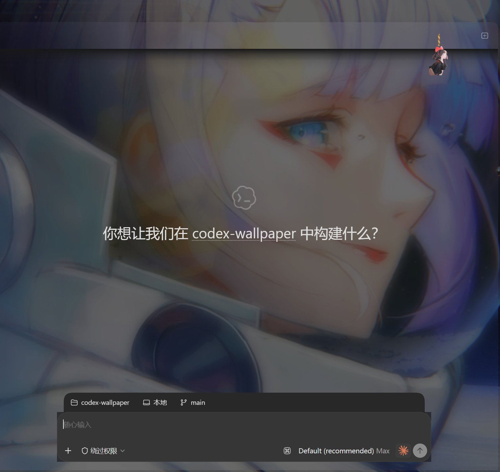
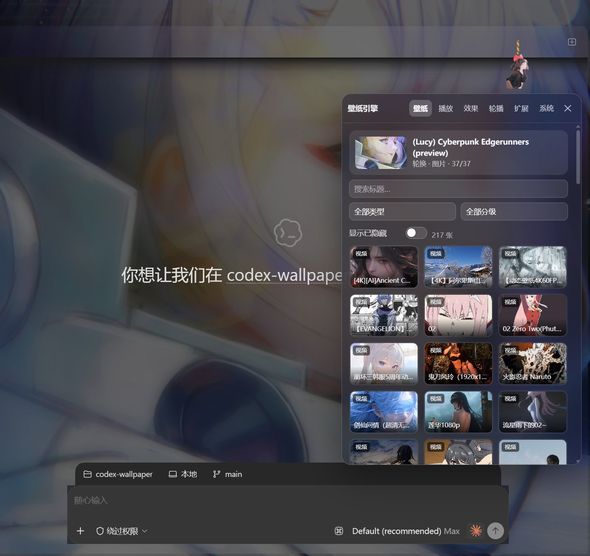
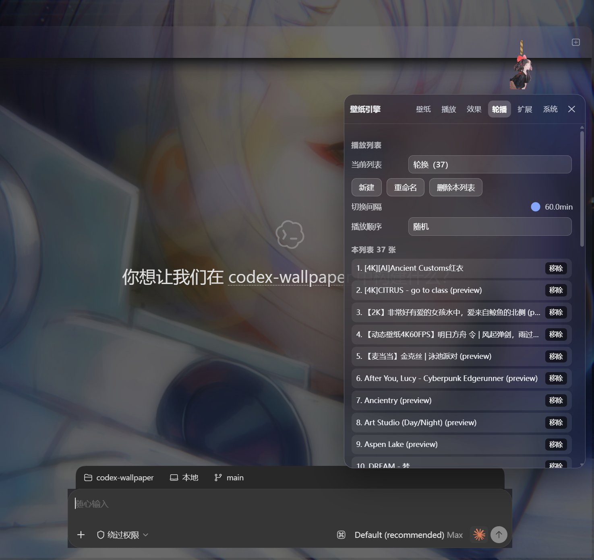
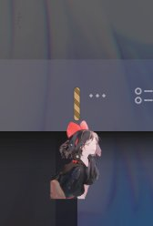

<div align="center">

# chatgpt-wallpaper-bridge

**把 Wallpaper Engine 的壁纸铺进官方 Windows 版 ChatGPT / Codex 桌面应用**

[](LICENSE)
[](#运行前提)
[](#运行前提)
[](#运行前提)



*Scene 壁纸经内嵌 WebGL 渲染器**实时渲染**，在磨砂玻璃的对话区后面流动（右上还挂着一只吉祥物）*

</div>

视频壁纸直接播；Scene / Web 壁纸不再是静态预览图——着色器、粒子、音频反应全部活过来。应用内自带六页签控制面板：播放列表轮换、七种过场动画、壁纸属性调节、点击/拖尾特效、3D 视差。不改 `WindowsApps` 里的任何安装文件，壁纸文件不出本机。

```
壁纸层（视频 / WebGL 实时场景，最底） → 暗化层 → 特效画布 → 半透磨砂对话面板（backdrop-filter） → 文字（清晰）
```

## 效果实况

<table>
<tr>
<td width="50%"></td>
<td width="50%"></td>
</tr>
<tr>
<td align="center"><sub>壁纸库：217 张自动入库，搜索 / 类型 / 分级筛选，点选即换</sub></td>
<td align="center"><sub>抽屉面板吊在吉祥物拉绳下方，六个页签管全部功能</sub></td>
</tr>
</table>



**顶边吉祥物拉绳**：麻绳垂着小人——下拉绳子弹长、松手弹回，拉过阈值即开出抽屉面板；左右拖动换位。内置四种形态，`mascot --file <图片>` 换上你自己的图（不透明照片会自动经 rembg 抠出人形主体再挂上去）。

<br clear="right">

## 功能

- **Scene/Web 实时渲染**：内嵌 WebWallGL 渲染器（钉版未改），scene.pkg 流式供给、LZ4/TEX 解码、着色器编译全在页面内完成——165 张场景/网页壁纸从"静态预览图"变成活壁纸
- **壁纸属性面板**：作者在 `project.json` 里开放的可调项（滑杆 / 开关 / 颜色 / 下拉 / 文件选择）按壁纸持久化，改动即时热下发
- **降级链**：实时渲染失败 → 作者内嵌 MP4（自动从 scene.pkg 提取）→ 预览图 → 跳过；首帧预算随包体缩放（336MB 的包也不会误判超时），失败壁纸本会话内记住不再重试
- **抓帧回填**：每张实时壁纸缓存一帧静图，轮换回来时**秒显**——渲染器就绪后再淡入，大包预热不再黑屏
- **六页签控制面板**：
  - **壁纸**：缩略图网格、搜索、类型 / 内容分级筛选、隐藏 / 恢复、点选即换
  - **播放**：暂停 / 上下张、倍速、音量、翻转；**七种过场**（硬切 / 淡化 / 推移 / 擦除 / 光圈 / 缩放 / 百叶窗 + 方向 + 速度）；实时渲染开关与帧率档（15/30/60）
  - **效果**：`原有外观 / 深色磨砂工作台` 显式切换；透明度 / 亮度 / 对比度 / 饱和度 / 模糊 / 暗化 / 缩放 / 位移；主工作区、输入框、**独立侧栏**分层调玻璃，原有外观仍可调对话内容卡片；可关闭的自动可读性只微调玻璃，不改主题
  - **轮播**：多播放列表（各自间隔与顺序）、CRUD、成员管理
  - **扩展**：点击效果（涟漪 / 星火）· 拖尾（彗尾 / 星尘）· 3D 视差 · 吉祥物设置
  - **系统**：会话头像、界面字体、省电三开关（隐藏 / 失焦 / 电池）、配置预设
- **深色磨砂工作台**：冷炭灰主工作区统一标题、正文与输入区域，transcript 不再叠第二块大背板；侧栏独立磨砂、壁纸低频亮度适应、浅色玻璃、减少动态效果与挂件安全避让。旧配置默认仍为 `legacy`，只有显式启用才套用新基线
- **主题随壁纸**：玻璃深浅 + **应用自身明暗主题**跟随壁纸（作者 schemecolor 与真实画面主色两票合议，WCAG 亮度阈值）；手动改过主题就让位，换下一张恢复。与工作台的“自动增强可读性”相互独立，后者只调玻璃、不改宿主主题
- **就绪后切换**：先把下一张预载到可播再过场；窗口隐藏 / 失焦 / 用电池时自动暂停（渲染器与视频一样省电）
- **生态互通**：`import-we` 直接导入 WE 官方客户端的播放列表；`import` 导入本地图片 / 视频；`autostart` 登录后隐藏自启；**会话头像**与**界面字体**可自定义

## 运行前提

- Windows 10 / 11
- 官方 **ChatGPT** 或 **Codex** 桌面应用（当前构建暴露本机 DevTools 端口，本工具依赖它注入）
- **Node.js ≥ 22**（只用内置模块，零 npm 依赖）
- Wallpaper Engine（Steam）可选——也可以直接 `import` / `set` 本地视频 / 图片文件
- 可选：Python + `rembg`（`pip install "rembg[cpu]"`）——自定义吉祥物照片自动抠图

## 快速开始

```powershell
# 1. 打开 ChatGPT / Codex 应用
# 2. 在本仓库目录运行：
node src/bridge.mjs start
```

首次启动且播放列表为空时，会自动把库里的全部视频壁纸收进轮换列表。桥接进程保持前台运行，`Ctrl+C` 或另开终端 `node src/bridge.mjs stop` 停止。

日常建议开一次自启，以后开机即隐身运行、应用一开就挂上；自启同时会注册并立即启动**看门狗**——桥接进程万一被杀（安全软件强杀、taskkill 等），只要应用开着就会在约一分钟内自动拉起，重启记录写在 `watchdog.log`：

```powershell
node src/bridge.mjs autostart        # 关闭: autostart --off（会连带停掉看门狗）
node src/bridge.mjs import-we        # 列出 WE 客户端播放列表；--apply <名称> 导入
```

然后点应用顶边的**吉祥物挂件**（下拉/点击），一切调节都在面板里完成；CLI 与面板完全等价（`node src/bridge.mjs help`）。

<details>
<summary><b>常用 CLI 速查</b>（面板里都有对应控件）</summary>

| 命令 | 作用 |
|---|---|
| `start` / `stop` / `status` | 启停桥接、查看状态 |
| `list [--all]` / `select <id>` | 列出库 / 立即切换 |
| `next` / `prev` / `goto <n>` / `play` / `pause` | 播放控制 |
| `set` / `add` / `clear` | 管理当前播放列表 |
| `rotate --interval <s> --order sequential\|shuffle` | 轮换节奏 |
| `fx --opacity … --transition bars …` | 画面与过场调节 |
| `live --on\|--off --fps 15\|30\|60` | 实时渲染开关与帧率 |
| `mascot --form whale\|…` / `--file <图>` | 吉祥物形态 / 自定义图 |
| `avatar --user <图> --assistant <图>` | 会话头像（`--clear`/`--off`） |
| `import <文件…>` / `import-we [--apply N]` | 导入本地文件 / WE 播放列表 |
| `preset ls\|save\|apply\|delete` | 整机配置快照 |
| `appearance workbench\|legacy\|restore` | 启用工作台 / 原有外观 / 只恢复优化前视觉字段 |
| `autostart [--off]` | 登录后隐藏自启（任务计划 ×2 + 启动文件夹；含看门狗） |
| `watchdog [off]` | 看门狗：应用开着时桥接被杀自动拉起 |

</details>

### 外观切换与视觉恢复

```powershell
node src/bridge.mjs appearance workbench   # 显式启用深色磨砂工作台
node src/bridge.mjs appearance legacy      # 只切回原有表面风格
node src/bridge.mjs appearance restore     # 恢复首次启用前的视觉字段
node src/bridge.mjs fx --sidebar-alpha-dark 0.78 --sidebar-blur 16
node src/bridge.mjs fx --no-auto-readability
```

首次启用前会在 `~/.chatgpt-wallpaper/backups/` 建立带时间戳的完整配置备份，并在 `~/.chatgpt-wallpaper/visual-restore.json` 保存视觉专用恢复点。`appearance restore` 只恢复外观、相关动效和挂件大小/位置，不回退播放列表、当前壁纸、切换时间、音量、倍速、live 设置、自定义资源或系统设置；它不同于会套用整机状态的 `preset apply`。面板「效果」页也提供同一条恢复入口。

相关内置测试（零依赖）：

```powershell
node --test tests/visual-style.test.mjs tests/commands-visual.test.mjs
```

## 工作原理

```
┌────────────────────────┐   CDP WebSocket      ┌──────────────────────────┐
│  bridge.mjs (Node)     │ ───────────────────► │  ChatGPT/Codex app       │
│  · 发现应用 DevTools   │   每2.5s 推送状态     │  inject.js 控制器:       │
│  · 附加 app://-/ 页面  │   applyState()       │   · 双槽位过场动画        │
│  · 轮换推进/命令执行   │ ◄─ 读回诊断 ──────── │   · 玻璃面板 <style>     │
│  · Fetch 拦截:         │                      │   · srcdoc 活层(WebGL)   │
│    wallpaper.local     │ ◄── <video>/ ── │   · 省电/取色/特效/视差   │
│    /media /thumb       │    元素加载媒体       │  panel.js 六页签面板     │
│    /frame /scene-video │                      │   · Image GET /api/cmd ─►│
│  · loopback 媒体源 ────┼── scene.pkg 流式 ───► │  (渲染器在 srcdoc iframe │
│    127.0.0.1 随机端口  │   渲染器静态文件      │   内运行, 与页面同源)     │
└────────────────────────┘                      └──────────────────────────┘
```

关键决策（都是踩坑换来的）：

1. **注入而非改文件**：通过 CDP `Runtime.evaluate` + `Page.addScriptToEvaluateOnNewDocument` 注入，跨页面导航存活，自愈重建。
2. **媒体走 Fetch 拦截**：`<video>/` 指向虚拟主机，桥接按 **Range 分段**供给本地文件（2 MB 块），4K 视频流式播放，零暴露面。
3. **状态推而非拉**：应用**改写了 `window.fetch` 做域名白名单**，页面无法轮询；桥接每 2.5 秒推状态、同一次调用读回诊断；页面命令走 Image GET `/api/cmd`（元素加载不受 fetch 补丁影响）。
4. **大包走 loopback 媒体源**：scene.pkg 实测最大 350MB，base64-over-CDP 单消息不可行——`127.0.0.1` 随机端口的迷你 HTTP 服务流式供给（Chromium 视 loopback 为可信源）；token 门控 + 双层路径围栏。
5. **渲染器跑在 srcdoc iframe 里**：应用守卫跨源 iframe 导航、且给主页面 fetch 打了补丁——但 srcdoc 文档**与应用同源**（可直接读写 `__wp` 控制面）、**fetch 未被补丁**、WebGL2 可用。`<base>` 指向媒体源，配置经 `__wp.setWallpaper()` 直推。
6. **玻璃用选择器而非令牌**：遮挡壁纸的是 `main[class*="MainContentSurface"]` 等语义类名（哈希后缀跨构建变化，语义部分稳定）。

迁移对照与取舍见 [docs/ROADMAP.md](docs/ROADMAP.md)。

## 已知限制

- 依赖应用暴露本机 DevTools 端口；若官方未来关闭，注入会失败（届时应改走浏览器扩展或独立 WebView 壳）。
- 桥接进程需常驻；未运行时壁纸层在下次页面刷新后消失，无副作用。看门狗（`autostart` 默认开启）会在桥接意外退出且应用开着时自动拉起；若安全软件（火绒等）反复强杀桥接，请将 `node.exe` 与启动项加入信任区。
- 音频反应类场景能听到声音（面板调音量）；WE 的 `application` 类型壁纸两边都不支持。

## 作者与致谢

- **[CPbianma](https://github.com/CPbianma)** — 项目发起、产品设计、测试与验收
- **[Claude](https://claude.ai/claude-code)**（Opus 5）— 架构设计与编码实现

渲染器与部分解析器 vendored 自 [dsh-wallpaper-engine](https://github.com/elysia395/dsh-wallpaper-engine)（MIT © elysia395），特此致谢。

## 免责声明

仅用于个人美化本机桌面应用；与 OpenAI / Wallpaper Engine 官方无关。应用更新可能导致选择器失效，欢迎 issue 反馈。
